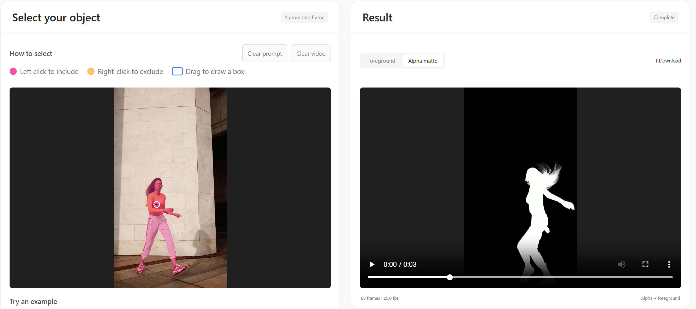

<div align="center">

<h2> Matting Anything 2: Towards Video Matting for Anything</h2>

<p>
Chenyi Zhang, Yiheng Lin, Yunchao Wei,
Hongsong Wang, Caifeng Shan, Fang Zhao<sup title="Corresponding author">†</sup>
</p>

<p><strong>ICLR 2026</strong> · <a href="https://iclr.cc/virtual/2026/poster/10011386">Paper</a></p>

</div>

## Quick Installation

### 1. Install dependencies


```bash
conda create -n mam2 python=3.10 -y
conda activate mam2
python -m pip install torch==2.5.1 torchvision==0.20.1 --index-url https://download.pytorch.org/whl/cu121
python -m pip install -e '.[demo]'
conda install -c conda-forge ffmpeg
```


### 2. Download model weights

The demo and inference CLI automatically download them on first use and reuse
the local cache. Weights are hosted on
[Hugging Face](https://huggingface.co/Chenyi007/Matting-Anything-2).


## Demo

Run the following command to launch the web demo:

```bash
CUDA_VISIBLE_DEVICES=0 OMP_NUM_THREADS=4 mam2-demo --config configs/web.yaml
```




## Inference & Evaluation

### YouTubeMatte inference

Download [YouTubeMatte](https://drive.google.com/file/d/1IEH0RaimT_hSp38AWF6wuwNJzzNSHpJ4/view)
and prepare its **1920 × 1080** test set with the following layout:

```text
datasets/YouTubeMatte/youtubematte_1920x1080/
├── youtubematte_motion/
│   ├── 0000/
│   │   ├── har/0000.jpg ... 0099.jpg  # RGB input frames
│   │   └── pha/0000.jpg ... 0099.jpg  # Ground-truth alpha
│   └── ... 0031/
└── youtubematte_static/
    └── 0000/ ... 0031/                # Same har/pha layout
```


**Box + clicks mode.** Run inference:

```bash
CUDA_VISIBLE_DEVICES=0 OMP_NUM_THREADS=4 \
mam2-benchmark infer --config configs/youtubematte.yaml \
  benchmark.data_root=/path/to/YouTubeMatte/youtubematte_1920x1080 \
  output.directory=outputs/youtubematte
```

**Mask guide mode.** Download the
[first-frame segmentation masks](https://drive.google.com/file/d/1Zpa7SB7VZmkvRDiehVC-c_0dmFWXdfzK/view?usp=sharing)
and extract the archive. 
Run mask-guided inference:

```bash
CUDA_VISIBLE_DEVICES=0 OMP_NUM_THREADS=4 \
mam2-benchmark infer --config configs/youtubematte_mask.yaml \
  benchmark.data_root=/path/to/YouTubeMatte/youtubematte_1920x1080 \
  benchmark.first_frame_mask_root=/path/to/YouTubeMatte_first_frame_seg_mask/youtubematte_1920x1080 \
  output.directory=outputs/youtubematte_mask
```


### Metric evaluation

Score the saved predictions with the same dataset and output directories:

```bash
CUDA_VISIBLE_DEVICES=0 OMP_NUM_THREADS=4 \
mam2-benchmark evaluate --config configs/youtubematte.yaml \
  benchmark.data_root=/path/to/YouTubeMatte/youtubematte_1920x1080 \
  output.directory=outputs/youtubematte
```


## Training

### Dataset Preparation

Follow the [dataset preparation guide](docs/data_preparation.md) for download
links and directory layout, then set `paths.data_root` in
[configs/datasets.yaml](configs/datasets.yaml).

### Stage 1: promptable main model

Download the pretrained
[SAM2.1 Hiera Large checkpoint](https://dl.fbaipublicfiles.com/segment_anything_2/092824/sam2.1_hiera_large.pt)
and save it as `checkpoints/sam2.1_hiera_large.pt`. Prepare the datasets, then run:

```bash
CUDA_VISIBLE_DEVICES=0,1,2,3 OMP_NUM_THREADS=4 \
mam2-train --config configs/train_main.yaml \
  paths.data_root=/path/to/datasets \
  paths.sam2_checkpoint=checkpoints/sam2.1_hiera_large.pt \
  launcher.processes=4
```

### Stage 2: lightweight matter

For the public Stage 2 setup, download the official
[ViTMatte-S checkpoint](https://drive.google.com/file/d/12VKhSwE_miF9lWQQCgK7mv83rJIls3Xe/view?usp=sharing)
and save it as `checkpoints/ViTMatte_S_Com.pth`. Then run:

```bash
CUDA_VISIBLE_DEVICES=0 OMP_NUM_THREADS=4 \
mam2-train --config configs/train_matter.yaml \
  paths.data_root=/path/to/datasets \
  training.teacher_checkpoint=checkpoints/ViTMatte_S_Com.pth
```


## Citation

```bibtex
@inproceedings{zhang2026mattinganything2,
  title={Matting Anything 2: Towards Video Matting for Anything},
  author={Zhang, Chenyi and Lin, Yiheng and Wei, Yunchao and Wang, Hongsong and Shan, Caifeng and Zhao, Fang},
  booktitle={International Conference on Learning Representations},
  year={2026}
}
```

## Contact

For questions, please contact [zchenyi007@gmai.com](mailto:zchenyi007@gmail.com).

## Acknowledgement

This project builds on [SAM2](https://github.com/facebookresearch/sam2),
[MEMatte](https://github.com/linyiheng123/MEMatte),
[ViTMatte](https://github.com/hustvl/ViTMatte) and
[MatAnyone](https://github.com/pq-yang/MatAnyone). We thank their authors
for sharing their work.
